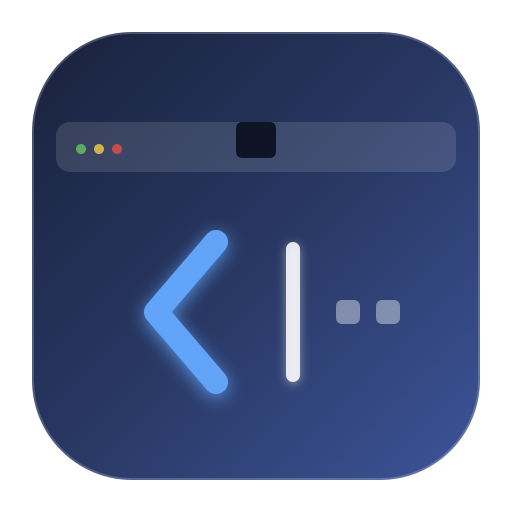

# MenuFold

<p align="center">
  
</p>

<p align="center">
  <strong>An ultra-light, open-source macOS menu bar folding & organizer for MacBook notch displays</strong><br>
  <sub>⌘ Drag-to-Fold · App Drawer Bubble · Reveal Hidden Notch Apps · 100% Zero Permissions</sub>
</p>

<p align="center">
  <b>English</b> | <a href="README.md">简体中文</a>
</p>

<p align="center">
  <a href="https://github.com/a916791360/MenuFold/releases/latest"></a>
  
  
  <a href="LICENSE"></a>
</p>

---

## 💡 Why MenuFold?

Modern MacBooks feature a camera notch in the top center of the display. When numerous menu bar items accumulate (messaging apps, cloud drives, system monitors, VPNs), icons on the left are frequently **occluded by the physical notch** or pushed completely off-screen, making them unreachable.

**MenuFold** provides an elegant dual solution to end notch occlusion forever:

1. **⌘ Drag-to-Fold Organization**: Hold **`⌘ (Command)`** on your keyboard to drag icons to the left of the separator, then click the arrow to fold them away instantly, freeing up menu bar space.
2. **App Drawer Bubble Popover (New in v1.1.0)**: When running many menu bar apps that exceed the physical space near the notch, simply **hover or click the separator** to reveal a quick-access bubble drawer. View, search, and launch any accessory tools or standard apps hidden behind the notch!

Zero dangerous accessibility permissions needed, pure Swift + AppKit, no memory leaks, ultra-lightweight (~30MB memory, 0% idle CPU).

---

## ✨ Features

- 🎯 **Native ⌘ + Drag Organization**: Uses macOS native menu bar arrangement (`⌘` + drag).
- 🪄 **One-Click Fold & Unfold**: Instantly collapse excess items behind the arrow to eliminate notch occlusion.
- 🫧 **App Drawer Bubble Popover (v1.1.0)**:
  - If you have too many status bar items exceeding the physical screen space near the notch, simply **hover over or click the separator** to reveal a quick-access bubble drawer!
  - Automatically aggregates background utilities (e.g. system monitors, cleaners, accessory tools) and standard apps.
  - Supports instant search, one-click bring-to-front window activation, and Finder/Quit actions.
  - Fully customizable hover sensitivity (0.15s / 0.25s / 0.50s / click only) and trigger targets.
- 🔄 **Native Update Checker**: Checks for new versions via GitHub Releases API automatically or on demand with direct download links.
- ⚡ **Zero Permissions & Ultra-Light**: No accessibility or screen recording permissions required; safe, private, and non-intrusive.
- 🚀 **Modern macOS Architecture**:
  - Uses modern `SMAppService` for launch-at-login (no legacy helper daemons).
  - Fully compatible with macOS 14, macOS 15 Sequoia, and newer.
  - Universal binary (`arm64` Apple Silicon M1/M2/M3/M4/M5 + `x86_64` Intel).
- ⌨️ **Global Shortcut**: Press `⌘ + ⌥ + B` anywhere to quickly toggle menu bar fold state.
- ⏱️ **Auto-Collapse Timer**: Optionally auto-collapse after 5s, 10s, 15s, or 30s.
- 🎨 **Appearance Customization**:
  - Arrow styles: Classic Chevron (`< / >`), Filled Triangle (`◀ / ▶`), Circle Badge.
  - Separators: Subtle Line (`|`), Dot (`•`), or Completely Hidden (Option-click arrow to toggle).
  - Configurable App Drawer bubble sensitivity and triggers.
- 🔒 **Always-Hidden Section**: Optional second separator for items you want to keep permanently hidden.

---

## 🖥 Layout & How It Works

```text
[Hidden / Folded Area]    [Separator]  [Toggle Arrow]       [Always Visible Area]
[WeChat] [Dropbox] [Stats]   │   |   │       <       │  [Wi-Fi] [Battery] [Control Center] [Clock]
──────────────────────────────────────────────────────────────────────────────────────────
                       ▼ Click Arrow to Fold ▼
[Camera Notch]                       │       >       │  [Wi-Fi] [Battery] [Control Center] [Clock]
```

### 3-Step Quick Start:
1. **Launch MenuFold**: A toggle arrow `<` and a subtle separator `|` will appear in your menu bar.
2. **Organize Icons**: Hold the **`⌘ (Command)`** key on your keyboard and drag any status bar icon with your mouse:
   - Drag to the **left of the separator**: tucked away in the folded zone (hidden when collapsed).
   - Keep to the **right of the separator**: stays permanently visible.
3. **Click to Fold**: Click the arrow (`<`) to tuck all icons on the left away. The arrow changes to `>`. Click again anytime to expand!

---

## 📥 Installation

### Option 1: Download Release (Recommended)

1. Go to the [GitHub Releases Page](https://github.com/a916791360/MenuFold/releases/latest).
2. Download `MenuFold.dmg` or `MenuFold.zip`.
3. Open `MenuFold.dmg` and drag **MenuFold.app** to your **Applications** folder.
4. **Gatekeeper Notice**: As a free and open-source project without Apple's paid Developer Certificate, macOS may prompt "Cannot verify developer" on first launch:
   - **Option A (System Settings)**: Open `System Settings` → `Privacy & Security`, scroll down to Security, and click **"Open Anyway"**.
   - **Option B (Right-Click Open)**: Hold `Control` and right-click `MenuFold.app`, select "Open", and click "Open" in the dialog.
   - **Option C (Terminal)**:
     ```bash
     xattr -cr /Applications/MenuFold.app
     ```

### Option 2: Build from Source

```bash
git clone https://github.com/a916791360/MenuFold.git
cd MenuFold

# Build release artifacts (DMG + ZIP)
./scripts/build_release.sh
```

Or open directly in Xcode:
```bash
open MenuFold.xcodeproj
```

---

## ⚙️ Shortcuts & Tips

| Action | Function |
| :--- | :--- |
| **Click Arrow (`<` / `>`)** | Toggle Fold / Expand |
| **Option + Click Arrow** | Quickly Show / Hide Separator line |
| **Right-click Arrow or Separator** | Open Context Menu (Preferences, Check for Updates, Auto-collapse, Quit) |
| **⌘ + ⌥ + B** | Global hotkey to toggle fold state anywhere |
| **Hold ⌘ and Drag** | Rearrange any status bar item |

---

## 🛠 Technical Details

- **OS Requirements**: macOS 14.0 or later (fully compatible with macOS 15 Sequoia).
- **Language**: Swift 5.9 / 6.0.
- **Frameworks**: Pure AppKit (`NSStatusBar`, `NSStatusItem`, `NSPopover`) + SwiftUI (`Settings`, `Guide`, `AppDrawer`).
- **Binary**: Universal Binary (`arm64` Apple Silicon + `x86_64` Intel).
- **Launch at Login**: Modern `ServiceManagement.SMAppService.mainApp` API.

---

## 📄 License

This project is licensed under the [MIT License](LICENSE). Contributions, bug reports, and pull requests are welcome!

If MenuFold helped you solve the MacBook notch issue, feel free to give it a ⭐️ Star on GitHub!
